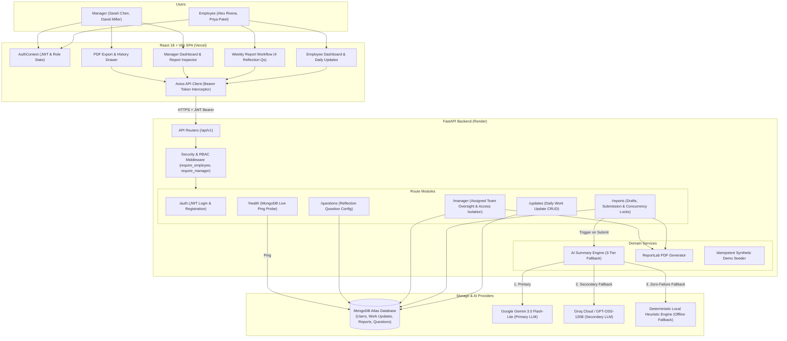

# 🚀 Employee Work & Weekly Reporting System

An enterprise-grade, backend-focused full-stack application built for technical assessment evaluation. The system enables employees to track daily work activities and complete standardized weekly reflection questions. Upon submission, the backend coordinates an atomic concurrency lock, marks the report immutable (read-only), triggers a multi-tier **AI Executive Summary** engine (Google Gemini → Groq Cloud → Deterministic Local NLP Heuristic), and routes the finalized report to the employee's assigned manager for oversight and official PDF export.

---

## 📋 Table of Contents

- [Project Overview](#-project-overview)
- [Key Features](#-key-features)
- [Architecture & Tech Stack](#-architecture--tech-stack)
- [System Architecture Diagram](#-system-architecture-diagram)
- [Repository Structure](#-repository-structure)
- [Seeded Demo Accounts & Credentials](#-seeded-demo-accounts--credentials)
- [AI Engine & Multi-Tier Fallback Strategy](#-ai-engine--multi-tier-fallback-strategy)
- [API Reference](#-api-reference)
- [Local Development Setup](#-local-development-setup)
- [Cloud Deployment Guide (Atlas + Render + Vercel)](#-cloud-deployment-guide-atlas--render--vercel)
- [Testing & Verification](#-testing--verification)

---

## 🌟 Project Overview

### What the System Does
The **Employee Work & Weekly Reporting System** provides a structured, role-segregated platform for team accountability and weekly status synthesis:
- **Employees** log daily work entries (with titles, category tags, descriptions, and hours spent), complete four standardized weekly reflection questions, save drafts, and submit finalized weekly reports.
- **Managers** review their assigned direct reports' submissions, inspect AI-generated executive summaries and recommendations, customize organization-wide reflection questions, manage team assignments, and export branded PDF reports.

### The Problem It Solves
Engineering teams frequently suffer from:
1. **Status Fragmentation**: Work updates scattered across Slack, Jira comments, and disjointed email threads.
2. **Managerial Overhead**: Managers spending hours each week reading through raw task logs to synthesize progress, identify blockers, and formulate next steps.
3. **Data Inconsistency & Submission Races**: Concurrent edits and race conditions between draft edits and report finalization leading to corrupt or partial weekly submissions.
4. **Fragile External Integrations**: LLM-dependent reporting systems failing completely whenever an external AI API experiences downtime, rate limits, or network timeouts.

### Who Uses It
- **Employees**: Log daily tasks, draft reflection answers, track hours, submit reports, and review submission history.
- **Managers**: Monitor team compliance, review submitted reports, read AI-synthesized summaries, download branded PDFs, assign team members, and configure reflection prompts.

### The End-to-End Workflow
```
[Daily Work Updates] ──> [Current Week Draft Auto-Linked] ──> [4 Reflection Answers]
                                                                        │
[Manager Dashboard]  <──  [Immutable PDF / AI Summary]   <──  [Atomic Submission Lock]
```
1. **Daily Logging**: Employees log work items across categories (`Feature`, `Bug Fix`, `Refactoring`, `Documentation`, `Meeting`, `Research`).
2. **Weekly Draft Aggregation**: The system automatically aggregates all work updates falling within the Monday-to-Sunday cycle into the employee's weekly draft.
3. **Reflection Questions**: The employee answers four mandatory reflection questions (Accomplishments, In Progress, Blockers, Next Priorities).
4. **Atomic Submission**: When submitted, the backend acquires an exclusive ownership claim token, validates answers, snapshots updates, and transitions the report to `submitted`.
5. **AI Synthesis**: The report triggers the 3-tier AI summarization pipeline. If Gemini or Groq are unavailable, the local deterministic NLP heuristic engine guarantees 100% completion reliability.
6. **Manager Review & PDF Export**: The report becomes strictly read-only. The manager inspects the report, reviews AI highlights and blocker recommendations, and exports an executive PDF.

---

## ✨ Key Features

- **Authentication & RBAC**:
  - Secure bcrypt password hashing and 7-day HS256 JWT access tokens.
  - Strict server-side role separation: Employees cannot access managerial routes; Managers cannot modify employee work logs.
  - Cross-Manager Isolation: Managers can only view and inspect reports belonging strictly to their assigned direct reports.
- **Daily Work Updates CRUD**:
  - Full CRUD operations with hours validation (`0 < hours <= 24`), date boundaries, and categorization.
  - Immutability Lock: Work updates belonging to an already submitted week cannot be edited or deleted.
- **Weekly Reporting & Draft Management**:
  - Auto-creation of drafts for the current Monday-to-Sunday cycle.
  - Real-time draft auto-saving with full recovery across sessions.
  - Mandatory validation requiring non-empty answers for all 4 reflection questions before submission.
- **Atomic Concurrency & Crash Recovery**:
  - Ownership-aware mutation lease protocol preventing race conditions between concurrent work updates and report submissions.
  - Automatic startup recovery reclaiming orphaned submissions (>120s) back to draft.
- **Multi-Tier AI Summarization**:
  - Primary: Google Gemini 3.5 Flash-Lite via Google AI Studio.
  - Secondary: Groq Cloud LLM (`openai/gpt-oss-120b`).
  - Offline Fallback: Deterministic local heuristic NLP engine that parses categories, hours, milestones, and blockers without external network calls.
- **Manager Oversight & Configuration**:
  - Team dashboard displaying submission status, AI summary snippets, and compliance counters.
  - Configurable weekly questions modal and management page (create, edit, toggle active/inactive).
  - Team assignment controls: assign and unassign direct reports dynamically.
- **Executive PDF Export**:
  - Server-side branded PDF generation via ReportLab with metadata tables, AI summaries, question reflections, and daily logs.
- **Report History**:
  - Historical timeline drawer enabling employees to view and download past weekly submissions.

---

## 🏗️ Architecture & Tech Stack

| Layer | Technologies | Purpose |
|---|---|---|
| **Frontend** | React 18, Vite, Tailwind CSS, Lucide Icons, Axios, React Router v6 | Responsive SPA with client-side RBAC guards, draft saving, and real-time state |
| **Backend** | Python 3.11+, FastAPI, Uvicorn, Pydantic v2, PyJWT, PassLib (Bcrypt) | High-performance asynchronous REST API with dependency injection & strict validation |
| **Database** | MongoDB Atlas, Motor (AsyncIOMotorClient), mongomock | Document persistence with compound indexes, transactions, and dev fallback |
| **PDF Engine** | ReportLab | Programmatic vector PDF compilation with corporate headers and tabular formatting |
| **AI Providers** | Google Gemini 3.5 Flash-Lite, Groq Cloud, Local NLP Heuristic | Multi-tier executive summary generation with zero-hallucination guardrails |
| **Hosting** | Vercel (Frontend SPA) + Render (Backend Web Service) | Production cloud deployment with SPA rewrites and health monitoring |

---

## 📐 System Architecture Diagram



---

## 📁 Repository Structure

```
employee_reporting_system/
├── render.yaml                    # Canonical Render Cloud Blueprint specification
├── README.md                      # Primary project documentation & evaluation guide
├── PLATFORM_OPERATIONS.md         # Comprehensive operations & security architecture manual
├── .gitignore                     # Git ignore rules (protects credentials, venv, cache)
│
├── backend/
│   ├── app/
│   │   ├── auth/                  # Security & authentication layer
│   │   │   ├── dependencies.py    # FastAPI dependencies (require_employee, require_manager)
│   │   │   ├── jwt.py             # JWT token creation, decoding, and validation
│   │   │   └── security.py        # PassLib bcrypt password hashing & verification
│   │   ├── models/                # Pydantic v2 validation models
│   │   │   ├── question.py        # Weekly reflection question schemas
│   │   │   ├── report.py          # Weekly report schemas, answers, AI summary models
│   │   │   ├── update.py          # Daily work update schemas & category constraints
│   │   │   └── user.py            # User registration, login, and response schemas
│   │   ├── routers/               # Modular FastAPI route controllers
│   │   │   ├── auth.py            # Authentication, registration, me, demo-users endpoints
│   │   │   ├── manager.py         # Team member overview, report inspection, assignment
│   │   │   ├── questions.py       # CRUD & toggle endpoints for reflection questions
│   │   │   ├── reports.py         # Draft saving, submission locking, history, PDF export
│   │   │   └── updates.py         # Daily work update CRUD & concurrency leases
│   │   ├── services/              # Domain logic services
│   │   │   ├── ai_summary.py      # 3-tier AI engine (Gemini -> Groq -> Local Heuristic)
│   │   │   ├── pdf_export.py      # ReportLab branded PDF generator
│   │   │   └── seed_data.py       # Idempotent demo account & question seeder
│   │   ├── config.py              # Environment settings (Pydantic-Settings) & CORS parsing
│   │   ├── database.py            # MongoDB connection manager (Motor AsyncIO client)
│   │   └── main.py                # FastAPI app initialization, CORS middleware, lifespan
│   ├── tests/                     # Automated test suites
│   │   ├── conftest.py            # Pytest module fixtures & test database setup
│   │   ├── test_api.py            # Core endpoint regression suite
│   │   └── test_comprehensive.py  # 46 deep tests: RBAC, concurrency, leases, fallbacks
│   ├── Dockerfile                 # Containerized backend build
│   ├── Procfile                   # Process file for web runtime
│   ├── pytest.ini                 # Pytest configuration
│   ├── requirements.txt           # Pinned Python package dependencies
│   ├── seed.py                    # Standalone CLI database seeding script
│   ├── test_gemini_live.py        # Direct script to verify live Gemini API keys
│   ├── test_runner.py             # Standalone E2E verification test runner
│   └── .env.example               # Backend environment variables template
│
└── frontend/
    ├── src/
    │   ├── components/            # Reusable React UI components
    │   │   ├── AISummaryCard.jsx  # Card displaying AI-synthesized executive summary
    │   │   ├── Navbar.jsx         # App navigation bar with user profile & logout
    │   │   ├── ProtectedRoute.jsx # Client-side role-based routing guard
    │   │   ├── QuestionConfigModal.jsx # Modal to manage reflection questions
    │   │   └── WorkUpdateModal.jsx# Modal to create and edit daily work updates
    │   ├── context/
    │   │   └── AuthContext.jsx    # React Context managing JWT token, user, and role
    │   ├── pages/                 # Full application views
    │   │   ├── EmployeeDashboard.jsx # Employee updates, draft preview, submission action
    │   │   ├── Login.jsx          # Login view with 1-click evaluation switcher
    │   │   ├── ManagerDashboard.jsx  # Manager team overview, reports list, PDF triggers
    │   │   ├── NotFound.jsx       # 404 error view
    │   │   ├── QuestionManagerPage.jsx # Full page to configure weekly questions
    │   │   ├── ReportDetailView.jsx  # In-depth inspection of submitted report & updates
    │   │   ├── ReportHistoryPage.jsx # Past submitted weekly reports timeline
    │   │   ├── Signup.jsx         # New employee registration view
    │   │   └── WeeklyReportPage.jsx  # 4 questions answer form & submit screen
    │   ├── services/
    │   │   └── api.js             # Axios client with Bearer token interceptor
    │   ├── utils/
    │   │   └── validators.js      # Client-side input validation helpers
    │   ├── App.jsx                # Route definitions and application layout
    │   ├── index.css              # Tailwind CSS styles and font configuration
    │   └── main.jsx               # React DOM entry point
    ├── test/
    │   └── frontend_suite.test.js # Node native test suite for validations and RBAC
    ├── package.json               # Frontend dependencies & build scripts
    ├── postcss.config.js          # PostCSS configuration
    ├── tailwind.config.js         # Tailwind CSS styling configuration
    ├── vercel.json                # Vercel SPA client-side rewrite configuration
    ├── vite.config.js             # Vite development server & proxy settings
    └── .env.example               # Frontend environment variables template
```

---

## 🔑 Seeded Demo Accounts & Credentials

The application includes an idempotent synthetic demo database seeder (`backend/app/services/seed_data.py`). When `SEED_DEMO_ACCOUNTS=true` is enabled, the following synthetic evaluation accounts are provisioned:

| Role | Name | Email | Password | Organization Unit | Reporting Relationship |
|:---|:---|:---|:---|:---|:---|
| **Manager** | **Sarah Chen** | `manager@company.com` | `Manager@123` | Engineering Core | Direct Manager of Alex Rivera & Priya Patel |
| **Manager** | **David Miller** | `david.manager@company.com` | `Manager@123` | Product & UX | Manager of Marcus Johnson (Cross-Manager Isolation) |
| **Employee** | **Alex Rivera** | `alex@company.com` | `Employee@123` | Engineering Core | Senior Software Engineer (Reports to Sarah Chen) |
| **Employee** | **Priya Patel** | `priya@company.com` | `Employee@123` | Engineering Core | Frontend Engineer (Reports to Sarah Chen) |
| **Employee** | **Marcus Johnson** | `marcus@company.com` | `Employee@123` | Product & UX | UI/UX Designer (Reports to David Miller) |

> 🔒 **Security Notice**:
> - These credentials are **strictly synthetic evaluation accounts** intended for assessment demonstration.
> - In production environments, set `ENABLE_DEMO_USERS=false` to disable the public `/api/v1/auth/demo-users` discovery endpoint.
> - After your initial deployment has seeded these accounts, set `SEED_DEMO_ACCOUNTS=false` in Render to permanently bypass seeding checks on subsequent service restarts.

---

## 🤖 AI Engine & Multi-Tier Fallback Strategy

The AI summarization engine (`backend/app/services/ai_summary.py`) analyzes the employee's work updates and weekly answers to produce:
1. **Executive Summary**: A concise 2–3 sentence overview grounded strictly in logged achievements.
2. **Key Highlights**: Bullet points summarizing the highest-impact completed items.
3. **Blockers Identified**: Explicit challenges surfaced from the reflection prompt.
4. **Manager Recommendation**: 1–2 actionable suggestions on how the manager can support the employee.

### 5-Step Resilient Execution Pipeline

```
1. Check GEMINI_API_KEY
   ├── Set? ──> Call Gemini 3.5 Flash-Lite (up to 2 attempts with exponential retry)
   │             ├── Success ──> Return structured summary (model: Google Gemini 3.5 Flash-Lite)
   │             └── Failure ──> Log sanitized error (API key redacted) & proceed to step 2
   └── Not Set ──> Proceed to step 2

2. Check GROQ_API_KEY
   ├── Set? ──> Call Groq Cloud (openai/gpt-oss-120b, up to 2 attempts with retry)
   │             ├── Success ──> Return structured summary (model: Groq Cloud)
   │             └── Failure ──> Log sanitized error (API key redacted) & proceed to step 3
   └── Not Set ──> Proceed to step 3

3. Deterministic Local NLP Heuristic Engine
   └── Analyzes logged categories, total hours, reflection answers, and milestones locally.
       Returns complete summary marked as:
       "model_used": "Built-in Intelligent Summary Engine (Free / Local Fallback)"
       ⚡ 100% submission reliability guaranteed — report submission NEVER fails due to AI downtime.
```

- **Credential Sanitization**: The helper `_sanitize_error(e, api_key)` automatically masks API keys before writing to application logs.
- **Zero Hallucination Guardrails**: Prompts strictly instruct models to base summaries *only* on provided updates and answers.

---

## 📡 API Reference

All application endpoints are versioned under `/api/v1`:

| Method | Endpoint | Authentication | Required Role | Description |
|:---|:---|:---|:---|:---|
| `POST` | `/api/v1/auth/register` | Public | None | Registers a new employee account (always assigned `employee` role) |
| `POST` | `/api/v1/auth/login` | Public | None | Authenticates credentials and returns a 7-day JWT Bearer token |
| `GET` | `/api/v1/auth/me` | Bearer Token | Any | Returns profile information for the authenticated user |
| `GET` | `/api/v1/auth/managers` | Public | None | Returns active managers for employee profile information |
| `GET` | `/api/v1/auth/demo-users` | Public | None | Returns demo accounts (disabled with 404 in production) |
| `GET` | `/api/v1/updates` | Bearer Token | Employee | Lists daily work updates for the logged-in employee |
| `POST` | `/api/v1/updates` | Bearer Token | Employee | Creates a new daily work update |
| `PUT` | `/api/v1/updates/{id}` | Bearer Token | Employee | Updates a work update (blocked if week's report is submitted) |
| `DELETE` | `/api/v1/updates/{id}` | Bearer Token | Employee | Deletes a work update (blocked if week's report is submitted) |
| `GET` | `/api/v1/questions` | Bearer Token | Any | Retrieves active weekly reflection questions |
| `POST` | `/api/v1/questions` | Bearer Token | Manager | Creates a new organization reflection question |
| `PUT` | `/api/v1/questions/{id}` | Bearer Token | Manager | Updates the prompt text of an existing question |
| `DELETE` | `/api/v1/questions/{id}` | Bearer Token | Manager | Deletes a question from future reports |
| `PATCH` | `/api/v1/questions/{id}/toggle` | Bearer Token | Manager | Toggles question status between active and inactive |
| `GET` | `/api/v1/reports/current` | Bearer Token | Employee | Gets or creates weekly report draft for the current week |
| `GET` | `/api/v1/reports/history` | Bearer Token | Employee | Lists past submitted reports for the logged-in employee |
| `GET` | `/api/v1/reports/{id}` | Bearer Token | Employee | Retrieves details for an employee's report |
| `POST` | `/api/v1/reports/draft` | Bearer Token | Employee | Saves draft reflection answers (cannot modify submitted reports) |
| `POST` | `/api/v1/reports/{id}/submit` | Bearer Token | Employee | Submits report, validates 4 answers, acquires claim lock, generates AI summary |
| `GET` | `/api/v1/reports/{id}/pdf` | Bearer Token | Employee / Mgr | Downloads official branded PDF report (restricted to owner or assigned manager) |
| `GET` | `/api/v1/manager/employees` | Bearer Token | Manager | Lists direct reports assigned strictly to the requesting manager |
| `GET` | `/api/v1/manager/reports` | Bearer Token | Manager | Lists weekly reports for assigned team members |
| `GET` | `/api/v1/manager/reports/{id}` | Bearer Token | Manager | Detailed report inspection (access-isolated across managers) |
| `GET` | `/api/v1/manager/unassigned-employees` | Bearer Token | Manager | Lists employees not currently assigned to any manager |
| `POST` | `/api/v1/manager/assign-employee` | Bearer Token | Manager | Claims an unassigned employee into the manager's team |
| `POST` | `/api/v1/manager/unassign-employee` | Bearer Token | Manager | Removes an employee from the manager's team |
| `GET` | `/` | Public | None | Service information, version, and status probe |
| `GET` | `/health` | Public | None | Live MongoDB connectivity health probe (200 healthy, 503 unavailable) |

---

## 💻 Local Development Setup

### Prerequisites
- **Python**: 3.10+ (tested on Python 3.11 and 3.14)
- **Node.js**: v18+ (tested on Node v20/v22) and npm
- **Database**: *(Optional)* Local MongoDB or MongoDB Atlas URI (if not configured, the backend automatically uses zero-config in-memory mock storage for local development)

---

### 1. Backend Setup

```bash
# Navigate to backend directory from repository root
cd backend

# Create Python virtual environment
python -m venv venv

# Activate virtual environment:
# Windows PowerShell:
.\venv\Scripts\Activate.ps1
# macOS / Linux:
source venv/bin/activate

# Install dependencies
pip install -r requirements.txt

# Configure environment variables
cp .env.example .env
# Edit .env to add your GEMINI_API_KEY (optional: local fallback activates if left blank)

# Start FastAPI development server
uvicorn app.main:app --reload --port 8000
```
FastAPI will start at `http://127.0.0.1:8000`.  
Explore interactive OpenAPI docs at `http://127.0.0.1:8000/docs`.

---

### 2. Frontend Setup

```bash
# In a new terminal, navigate to frontend directory from repository root
cd frontend

# Install npm dependencies
npm install

# Start Vite development server
npm run dev
```
Open your browser at `http://localhost:5173`.

---

## 🌐 Cloud Deployment Guide (Atlas + Render + Vercel)

> **Scope Notice**: Email delivery and SMTP deadline reminder notifications are intentionally **not included**. The application focuses on daily tracking, reflection answers, atomic weekly report submission, AI summarization, PDF export, and manager accountability oversight.

### 1. MongoDB Atlas Setup
1. Create a free shared cluster (M0) on [MongoDB Atlas](https://www.mongodb.com/atlas).
2. **Database Access**: Create a database user (e.g. `reporting_user`) with `Read and write to any database` privileges. Ensure any reserved characters in the password (`@`, `:`, `/`) are URL-encoded.
3. **Network Access**: Add IP `0.0.0.0/0` (Allow Access from Anywhere) to permit connections from Render's cloud instances.
4. Copy your connection string:
   `mongodb+srv://reporting_user:<PASSWORD>@cluster0.mongodb.net/employee_reporting_db?retryWrites=true&w=majority`

### 2. Backend Deployment on Render
Deploy using the canonical root `render.yaml` Blueprint or create a manual Web Service:

- **Root Directory**: `backend`
- **Runtime**: `Python 3`
- **Build Command**: `pip install -r requirements.txt`
- **Start Command**: `uvicorn app.main:app --host 0.0.0.0 --port $PORT`
- **Health Check Path**: `/health`

**Environment Variables in Render**:
| Variable | Value | Description |
|---|---|---|
| `ENVIRONMENT` | `production` | Enforces production security, blocks mock fallback |
| `MONGODB_URI` | *Your Atlas Connection URI* | Live MongoDB connection string |
| `DATABASE_NAME` | `employee_reporting_db` | MongoDB database name |
| `JWT_SECRET_KEY` | *Minimum 32-character secret* | Secure token signing key |
| `ALGORITHM` | `HS256` | JWT signing algorithm |
| `ACCESS_TOKEN_EXPIRE_MINUTES` | `10080` | Token lifetime (7 days) |
| `BACKEND_CORS_ORIGINS` | `["https://your-app.vercel.app"]` | Your exact Vercel frontend URL (string, comma-separated, or JSON) |
| `SEED_DEMO_ACCOUNTS` | `true` | Seeds initial assessment accounts. Set to `false` after initial boot. |
| `ENABLE_DEMO_USERS` | `false` | Disables public `/demo-users` discovery endpoint |
| `GEMINI_API_KEY` | *(Optional)* Google AI Studio key | Primary LLM provider key |
| `GEMINI_MODEL` | `gemini-3.5-flash-lite` | Primary LLM model identifier |
| `GROQ_API_KEY` | *(Optional)* Groq API key | Secondary fallback LLM key |

### 3. Frontend Deployment on Vercel
1. Log in to [Vercel](https://vercel.com/) and click **Add New → Project**.
2. Import this repository.
3. Configure settings:
   - **Framework Preset**: `Vite`
   - **Root Directory**: `frontend`
   - **Build Command**: `npm run build`
   - **Output Directory**: `dist`
4. Set Environment Variables:
   - `VITE_API_BASE_URL`: `https://your-backend-app.onrender.com/api/v1` *(Your Render URL + /api/v1)*
5. Click **Deploy**. Vercel will build the frontend with full SPA client-side routing powered by `frontend/vercel.json`.

### 4. Health Check Probe
Query your deployed backend health endpoint:
```bash
curl https://your-backend-app.onrender.com/health
```
Response:
```json
{
  "status": "healthy",
  "service": "Employee Work & Weekly Reporting System",
  "environment": "production",
  "database": "mongodb_connected"
}
```
If MongoDB Atlas is unreachable, the endpoint returns HTTP `503 Service Unavailable`, preventing traffic from reaching an unbacked API.

---

## 🧪 Testing & Verification

### Running Backend Tests

#### Option A: From Repository Root
```bash
# Comprehensive regression test suite (53 tests)
pytest -c backend/pytest.ini backend/tests/ -v

# Targeted API regression suite
pytest -c backend/pytest.ini backend/tests/test_api.py -v
```

#### Option B: From Inside `backend/` Directory
```bash
cd backend
# Run test suite
pytest -c pytest.ini tests/ -v
```

#### Option C: Standalone E2E Verification Runner
```bash
# Runs full end-to-end integration test flow against live FastAPI instance
python backend/test_runner.py
```

### Running Frontend Tests & Production Build
```bash
cd frontend

# Run unit tests and RBAC validation suite
npm test

# Run production Vite build
npm run build
```

---

## 📄 License & Attribution

This project is submitted as an evaluation deliverable for the Technical Assessment. Designed and implemented with clean architecture, zero-hallucination AI integration, and robust concurrency guarantees.
